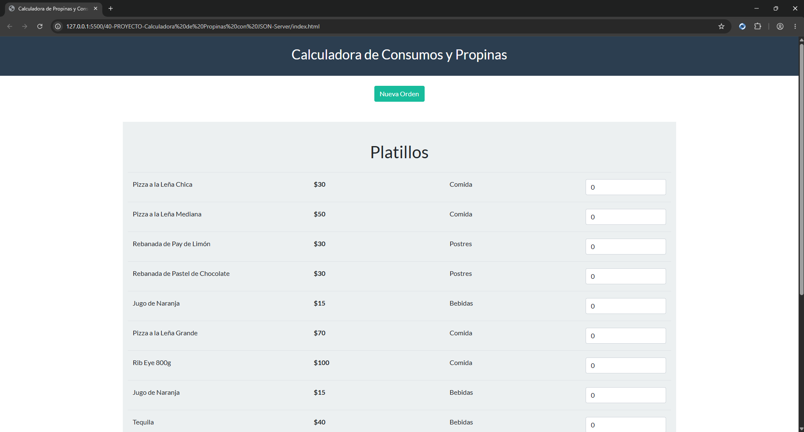

# 🍽️ Calculadora de Consumos y Propinas

Aplicación web desarrollada con **HTML5, CSS3, Bootstrap y JavaScript** que permite administrar órdenes de consumo de un restaurante y calcular automáticamente el importe de las propinas.

La aplicación obtiene el catálogo de platillos mediante una API REST simulada con **JSON Server**, permitiendo seleccionar productos, establecer cantidades y visualizar el resumen de consumo.

Este proyecto forma parte de mi aprendizaje de JavaScript y está enfocado en la práctica del consumo de APIs, manipulación del DOM y operaciones con arreglos y objetos.

## 🚀 Demo

🔗 [Ver aplicación en GitHub Pages](https://cristhianychr.github.io/calculadora-propinas-json-server/)

## 📸 Vista previa



## ✨ Funcionalidades

- **Crear órdenes:** permite registrar una orden indicando el número de mesa y la hora.
- **Consultar platillos:** obtiene el catálogo de productos desde JSON Server.
- **Clasificar productos:** organiza los platillos en las categorías de comida, bebidas y postres.
- **Seleccionar productos:** permite indicar las cantidades de cada platillo.
- **Actualizar pedidos:** modifica las cantidades de productos que ya fueron agregados.
- **Eliminar productos:** permite retirar artículos individuales del pedido.
- **Visualizar el resumen:** muestra la mesa, hora, productos seleccionados, cantidades, precios y subtotales.
- **Calcular consumos:** obtiene automáticamente el subtotal de los productos seleccionados.
- **Calcular propinas:** permite seleccionar porcentajes del 10%, 25% o 50%.
- **Calcular total a pagar:** suma el subtotal del consumo y la propina seleccionada.
- **Validar formularios:** comprueba que se hayan ingresado la mesa y la hora antes de crear una orden.

## 🛠️ Tecnologías utilizadas

- **HTML5:** estructura de la aplicación y formularios.
- **CSS3:** estilos personalizados.
- **Bootstrap 5:** componentes visuales, diseño responsive y ventanas modales.
- **JavaScript (ES6+):** lógica de la aplicación y manipulación del DOM.
- **Fetch API:** comunicación con la API REST.
- **JSON Server:** simulación de un servidor REST utilizando un archivo JSON.
- **Git y GitHub:** control de versiones y publicación del proyecto.

## 🧠 Conceptos de JavaScript aplicados

- Manipulación del DOM.
- Gestión de eventos con `addEventListener` y `onclick`.
- Consumo de APIs mediante `fetch()`.
- Programación asíncrona con promesas y `.then()`.
- Procesamiento de respuestas JSON.
- Desestructuración de objetos y arreglos.
- Operador de propagación (*spread operator*).
- Métodos de arreglos:
  - `some()`
  - `map()`
  - `filter()`
  - `forEach()`
- Funciones flecha.
- Template literals.
- Validación de formularios.
- Creación dinámica de elementos HTML.
- Actualización de objetos y arreglos.
- Cálculos dinámicos de subtotales, propinas y totales.
- Manipulación de clases CSS con `classList`.
- Temporizadores con `setTimeout()`.

## 🌐 API REST con JSON Server

El proyecto utiliza **JSON Server** para simular una API REST a partir del archivo `db.json`.

El archivo contiene un catálogo de platillos con información como:

- ID del producto.
- Nombre.
- Precio.
- Categoría.

### Endpoint utilizado

| Método HTTP | Endpoint | Funcionalidad |
|---|---|---|
| GET | `/platillos` | Obtener el catálogo de platillos. |

La aplicación realiza una solicitud a:

```text
http://localhost:3000/platillos
```

Los datos recibidos se procesan mediante Fetch API y se muestran dinámicamente en la interfaz.

## 📂 Estructura del proyecto

```text
calculadora-propinas-json-server/
├── css/
│   ├── app.css
│   └── bootstrap.min.css
├── img/
│   └── preview.png
├── js/
│   ├── app.js
│   └── bootstrap.bundle.min.js
├── db.json
├── index.html
├── .gitignore
└── README.md
```

## ⚙️ Instalación y ejecución

### Requisitos

- Node.js y npm instalados.
- Navegador web.
- Visual Studio Code (recomendado).

### 1. Clonar el repositorio

```bash
git clone https://github.com/cristhianychr/calculadora-propinas-json-server.git
```

### 2. Acceder a la carpeta

```bash
cd calculadora-propinas-json-server
```

### 3. Iniciar JSON Server

Ejecuta el siguiente comando en la terminal:

```bash
npx json-server db.json
```

Este comando inicia el servidor y permite consultar el catálogo de platillos mediante:

```text
http://localhost:3000/platillos
```

Si es la primera ejecución, `npx` puede solicitar autorización para descargar JSON Server.

### 4. Abrir la aplicación

Abre el proyecto en Visual Studio Code y ejecuta `index.html` utilizando Live Server.

Mantén abierta la terminal donde se está ejecutando JSON Server mientras utilizas la aplicación.

## 📌 Aprendizajes

Este proyecto me permitió comprender cómo consumir una API REST simulada utilizando JSON Server y cómo obtener información almacenada en un archivo JSON mediante Fetch API.

También reforcé la manipulación de arreglos y objetos, el manejo de eventos, la actualización dinámica de la interfaz y la implementación de cálculos relacionados con órdenes de consumo y propinas.

## 👨‍💻 Autor

Proyecto desarrollado como parte de mi formación práctica en JavaScript y desarrollo web.

**Cristhian Chanamé**  
Estudiante de Ingeniería de Software.